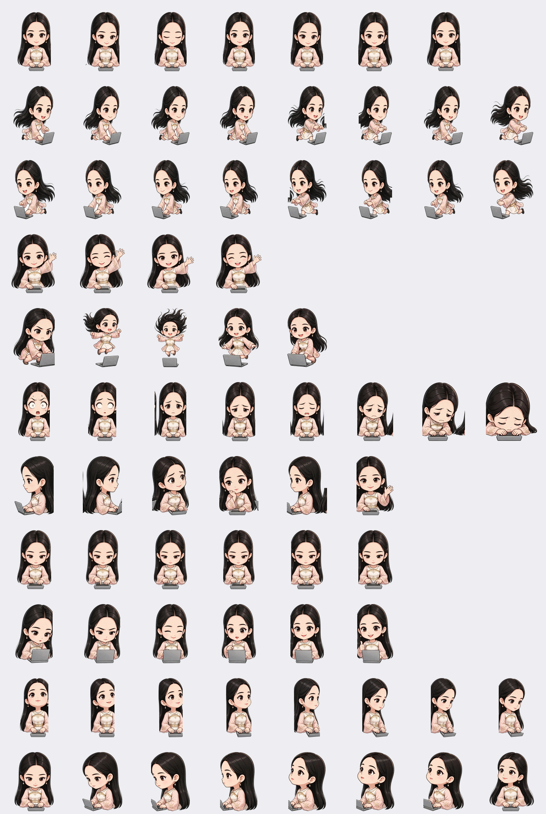

# codex/ — Pink Hanfu (Codex pet)

**English | [中文](README.zh-CN.md)**

Codex Pet v2 import package. The character is the pink-hanfu look in
[`../muse/`](../muse/), and every frame was redrawn individually.

## Install

Copy the whole `pink-hanfu/` folder to:

- macOS / Linux: `~/.codex/pets/pink-hanfu/`
- Windows: `%USERPROFILE%\.codex\pets\pink-hanfu\`
- With `CODEX_HOME` set: `$CODEX_HOME/pets/pink-hanfu/`

The folder must directly contain `pet.json` and `spritesheet.webp`
(no extra nesting). Then open the ChatGPT / Codex desktop app →
Settings → Pets → Refresh, and select "粉白古装 · Pink Hanfu".

## Preview

| idle | waving | working | jumping |
|---|---|---|---|
|  |  |  |  |

## Files

| Path | Description |
|---|---|
| `pink-hanfu/pet.json` | Manifest: id / displayName / description / spriteVersionNumber 2 / spritesheetPath |
| `pink-hanfu/spritesheet.webp` | Sprite sheet: 1536×2288, 8×11, 192×208 per cell, transparent, ~1.7 MB |
| `preview/contact-sheet.png` | Full sheet preview |
| `preview/*.gif` | Animated previews: idle / waving / working / jumping |

## Spec

| Item | Value |
|---|---|
| Format | Codex Pet v2 |
| Sheet size | 1536 × 2288 px (8 columns × 11 rows) |
| Cell | 192 × 208 px, transparent WebP |
| Frames | 74 used cells (plus a neutral front-facing cell) |

| Row | State | Frames | Content |
|---|---|---|---|
| 0 | idle | 6 (+ neutral) | breathing, blinking |
| 1 | running-right | 8 | running right, hair flowing back |
| 2 | running-left | 8 | running left (mirror-derived from the right run, allowed by the spec) |
| 3 | waving | 4 | raising a hand to say hello |
| 4 | jumping | 5 | crouch, leap, airborne, fall, landing |
| 5 | failed | 8 | from stunned and drooping to face-down on the keyboard |
| 6 | waiting | 6 | looking around, chin in hand, beckoning |
| 7 | running (working) | 6 | focused typing |
| 8 | review | 6 | leaning in to inspect, nodding, thumbs up |
| 9–10 | look directions | 16 | clockwise from straight up, one gaze every 22.5° |

## Production notes

- Every frame was **individually redrawn** — no displacement/scale transforms of a single image: expressions, poses and hair movement differ frame by frame
- The look-direction set originally had only 7 of 8 frames drawn; the missing 337.5° frame was drawn separately to complete it
- Assembly only did background removal, frame slicing and size normalization; a few frames may keep a hair-thin strand from a neighbouring frame at the edge, essentially invisible at actual pet display size

## Make a pet for another character

Follow the repo [tutorial](../../../TUTORIAL.md): it documents the whole pipeline
used for this pet — drawing the 11 action strips frame by frame, slicing and
cleaning, assembling the 1536×2288 sheet, writing `pet.json`, validating, and
installing — including a suggested pet id per character.
