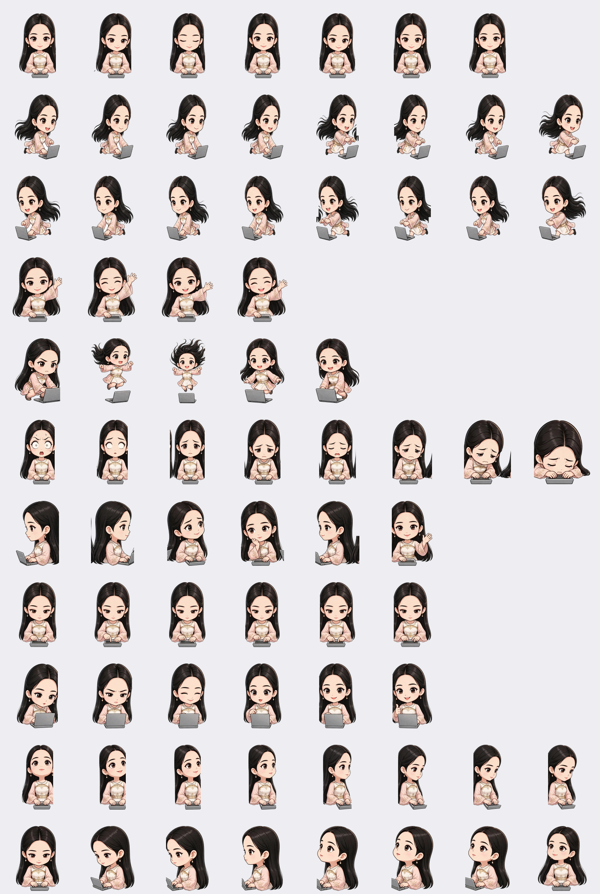

# codex/ — 粉白古装（Codex 宠物）

**[English](README.md) | 中文**

Codex Pet v2 导入包。角色就是 [`../muse/`](../muse/) 里的粉白古装造型，
每一帧都是单独重绘的。

## 安装

把整个 `pink-hanfu/` 文件夹复制到：

- macOS / Linux：`~/.codex/pets/pink-hanfu/`
- Windows：`%USERPROFILE%\.codex\pets\pink-hanfu\`
- 设置了 `CODEX_HOME` 时：`$CODEX_HOME/pets/pink-hanfu/`

文件夹里要直接放着 `pet.json` 和 `spritesheet.webp`（不要多套一层）。
然后打开 ChatGPT / Codex 桌面端 → 设置 → Pets → Refresh，
选择「粉白古装 · Pink Hanfu」。

## 预览

| 空闲 | 挥手 | 工作 | 跳跃 |
|---|---|---|---|
|  |  |  |  |

## 文件

| 路径 | 说明 |
|---|---|
| `pink-hanfu/pet.json` | 清单：id / displayName / description / spriteVersionNumber 2 / spritesheetPath |
| `pink-hanfu/spritesheet.webp` | 精灵图：1536×2288，8×11，每格 192×208，透明，约 1.7 MB |
| `preview/contact-sheet.png` | 整张精灵图预览 |
| `preview/*.gif` | 动图预览：idle / waving / working / jumping |

## 规格

| 项目 | 数值 |
|---|---|
| 格式 | Codex Pet v2 |
| 精灵图尺寸 | 1536 × 2288 px（8 列 × 11 行） |
| 单格 | 192 × 208 px，透明 WebP |
| 帧数 | 74 个有效格（外加 1 个正面中立格） |

| 行 | 状态 | 帧数 | 内容 |
|---|---|---|---|
| 0 | idle | 6（+ 中立） | 呼吸、眨眼 |
| 1 | running-right | 8 | 向右跑，头发向后飘 |
| 2 | running-left | 8 | 向左跑（由向右跑镜像得到，规范允许） |
| 3 | waving | 4 | 抬手打招呼 |
| 4 | jumping | 5 | 下蹲、起跳、腾空、下落、落地 |
| 5 | failed | 8 | 从呆住、垂头到趴在键盘上 |
| 6 | waiting | 6 | 东张西望、托腮、招手 |
| 7 | running (working) | 6 | 专注敲键盘 |
| 8 | review | 6 | 凑近检查、点头、点赞 |
| 9–10 | 视线方向 | 16 | 从正上方顺时针，每 22.5° 一个视线 |

## 制作说明

- 每一帧都是**单独重绘**的，没有用单张图做位移/缩放变换：表情、姿势和头发动态逐帧不同
- 视线方向组最初只画了 8 帧中的 7 帧，缺的 337.5° 那帧是后来单独补画的
- 组装阶段只做了去背景、切片和尺寸归一化；少数帧边缘可能留有隔壁帧一丝头发，在宠物实际显示尺寸下基本看不见

## 给其他形象做宠物

看仓库的[教程](../../../TUTORIAL.zh-CN.md)：完整记录了这只宠物的制作流程
——逐帧画 11 组动作条、切片清理、组装 1536×2288 精灵图、写 `pet.json`、
校验和安装——并附了每个形象建议的宠物 id。
