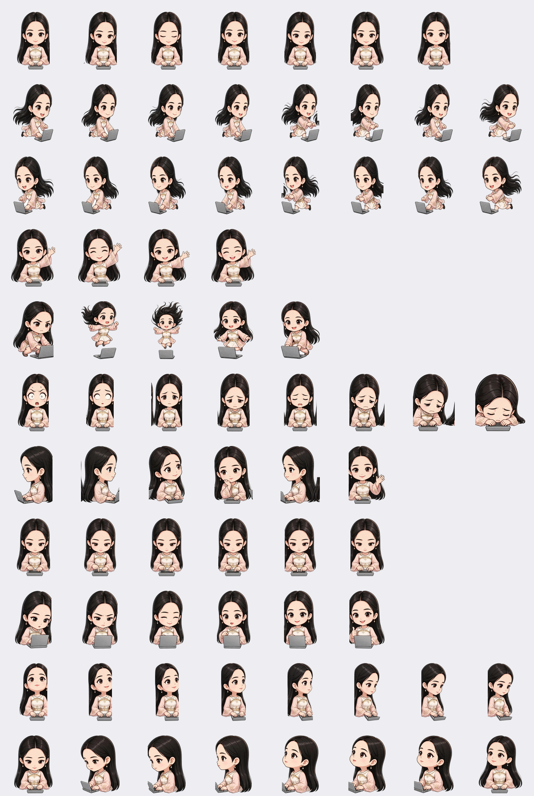

# Muse · 粉白古装 — 虚拟形象 & Codex 智能伙伴

> 一个大头卡通虚拟形象的双平台素材仓库：`muse/` 是她在 Muse 里的头像形象，
> `codex/` 是把同一形象逐帧重绘后做成的 Codex 桌面智能伙伴（Pet）导入包。


## 角色介绍

- **形象**：大头可爱卡通女孩，长黑直发中分，珍珠耳坠
- **服装**：粉白金纹刺绣古装（白色上衣配金线刺绣、粉色广袖）
- **标志动作**：坐在小笔记本电脑前敲键盘
- **由来**：最初是 Muse 个人助手的自定义头像（周一造型，一周七套轮换之一），
  之后应需求把这个形象完整重绘成 Codex 可导入的动画伙伴

## 预览

Codex 版整张动画图集（8 列 × 11 行）：



| 待机 idle | 挥手 waving | 工作 working | 跳跃 jumping |
|---|---|---|---|
|  |  |  |  |

## 仓库结构

```
.
├── README.md                  # 本页
├── muse/                      # Muse 平台形象
│   ├── avatar.webp            # 主头像（1600×1600）
│   ├── states/                # 深色模式状态图：idle / working /
│   │                          #   making_something / milestone_level_up / waking
│   └── README.md
└── codex/                     # Codex 平台智能伙伴
    ├── muse-pink-hanfu/
    │   ├── pet.json           # 伙伴清单（spriteVersionNumber: 2）
    │   └── spritesheet.webp   # 动画图集（1536×2288，透明底）
    ├── preview/               # 图集预览图与动图
    └── README.md              # 安装说明
```

## Codex 版安装（本地导入）

1. 把 `codex/muse-pink-hanfu/` 整个文件夹复制到 Codex 的 pets 目录：
   - macOS / Linux：`~/.codex/pets/`
   - Windows：`%USERPROFILE%\.codex\pets\`
   - 如果设置了 `CODEX_HOME`，则放到 `$CODEX_HOME/pets/` 下
2. 打开 ChatGPT / Codex 桌面版 → **Settings → Pets → Refresh**
3. 选择 **「Muse · 粉白古装」**，用 `/pet` 唤醒或收起

## Codex 图集规格

| 项目 | 值 |
|---|---|
| 格式 | Codex Pet v2 |
| 图集尺寸 | 1536 × 2288 px（8 列 × 11 行） |
| 单格 | 192 × 208 px，透明背景 WebP |
| 帧数 | 74 格（另含中立正视格） |

| 行 | 状态 | 帧数 | 内容 |
|---|---|---|---|
| 0 | idle | 6（+中立格） | 呼吸起伏、眨眼 |
| 1 | running-right | 8 | 向右奔跑，头发后飘 |
| 2 | running-left | 8 | 向左奔跑（由右行帧镜像派生，契约允许） |
| 3 | waving | 4 | 举手挥手打招呼 |
| 4 | jumping | 5 | 下蹲、起跳、腾空、下落、落地 |
| 5 | failed | 8 | 从愣住、垂头到趴在键盘上 |
| 6 | waiting | 6 | 东张西望、托腮、招手催促 |
| 7 | running（工作） | 6 | 专注敲键盘 |
| 8 | review | 6 | 凑近检查、点头、竖大拇指 |
| 9–10 | look directions | 16 | 从正上开始顺时针每 22.5° 一个看向 |

## 制作说明

- 每一帧均为**单独重绘**，不是单张图的位移/缩放变换：表情、姿势、头发飘动逐帧不同
- 看向方向原组只画出 7 帧，缺失的 337.5° 一帧为单独补绘
- 拼装时只做抠透明底、切帧与尺寸归一化；个别帧边缘可能残留极细的邻帧发丝，
  在宠物实际显示尺寸下基本不可见

## 免责声明

本仓库为个人非商业粉丝创作，角色为卡通风格化形象，与艺人本人及
OpenAI、Meta 等公司无关，请勿用于商业用途。
