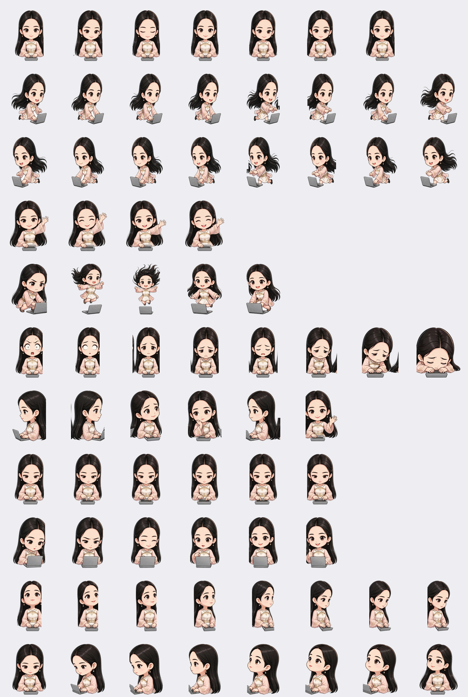

# AI Atelier — 虚拟形象与 Codex 宠物

**[English](README.md) | 中文**

> **AI造物局**的工坊：大头 Q 版虚拟形象合集。中国风造型合并成一个
> 系列文件夹，其余形象各自一个带序号的文件夹。每个造型内部：
> `muse/` 放 Muse 头像素材，`codex/` 放 Codex 桌面宠物（已做好的，
> 或计划中并附建议宠物 id）。

## 汉服旗袍系列

| 01 · 粉白古装 | 02 · 青绿古装 | 03 · 红色金纹古装 | 04 · 白衣古装 | 05 · 薄荷绿旗袍 |
|---|---|---|---|---|
|  |  |  |  |  |

## 其他形象

| 02 · 紫色珍珠礼服 | 03 · 浅蓝西装 | 04 · 粉色毛衣 | 05 · 林一一 | 06 · 原创双马尾 |
|---|---|---|---|---|
|  |  |  |  |  |

| # | 文件夹 | 内容 | Codex 宠物 |
|---|---|---|---|
| 01 | [汉服旗袍系列](01-hanfu-qipao/) · Hanfu & Qipao series | 5 个中国风造型：粉白古装（周一）、青绿古装（周二）、红色金纹古装（周四）、白衣古装（周六）、薄荷绿旗袍（备用） | ✅ 粉白已做好，其余计划中 |
| 02 | [紫色珍珠礼服](02-purple-pearl-dress/) · Purple pearl dress | 每周轮换的周三造型 | 计划中 |
| 03 | [浅蓝西装现代装](03-light-blue-suit/) · Light blue suit | 周五 | 计划中 |
| 04 | [粉色毛衣日常装](04-pink-sweater/) · Pink sweater | 周日 | 计划中 |
| 05 | [林一一](05-lin-yiyi/) · Lin Yiyi | Q版林一一，抖音短剧《我的妹妹不可爱》角色；2026-11-20 起担任 Muse 头像 | 计划中 |
| 06 | [原创双马尾](06-twin-tails/) · Twin-tails | 完全原创的像素风大头 Q 版女孩 | 计划中 |

每周轮换（周一至周日）是同一个形象的七套造型——大头、上半身、
敲电脑——外加备用旗袍。05 和 06 是像素风 Q 版的独立形象。

## 仓库结构

```
.
├── README.md / README.zh-CN.md   # 本页
├── TUTORIAL.md / TUTORIAL.zh-CN.md
│                                 # 把任何形象做成 Codex 宠物的教程
├── 01-hanfu-qipao/               # 汉服旗袍系列
│   ├── README.md                 # 系列总览
│   ├── 01-pink-hanfu/            # 每个造型一个文件夹，内含：
│   │   ├── README.md             #   造型总览
│   │   ├── muse/                 #   Muse 头像素材（+ README）
│   │   └── codex/                #   Codex 宠物包或计划（+ README）
│   ├── 02-teal-hanfu/
│   ├── ...
│   └── 05-mint-qipao/
├── 02-purple-pearl-dress/        # 独立形象，内部结构相同
├── ...
└── 06-twin-tails/
```

## Codex 宠物

目前只有**粉白古装**有宠物：一只逐帧重绘的 Codex Pet v2
（8 列 × 11 行，1536×2288）。完整规格、预览和安装说明见
[`01-hanfu-qipao/01-pink-hanfu/codex/`](01-hanfu-qipao/01-pink-hanfu/codex/)。



| 空闲 | 挥手 | 工作 | 跳跃 |
|---|---|---|---|
|  |  |  |  |

**安装**：把 `01-hanfu-qipao/01-pink-hanfu/codex/pink-hanfu/` 复制到
`~/.codex/pets/`（Windows：`%USERPROFILE%\.codex\pets\`），然后在
ChatGPT / Codex 桌面端打开 **设置 → Pets → Refresh**，
选择「粉白古装 · Pink Hanfu」。

想给其他造型做宠物？看 [**TUTORIAL.zh-CN.md**](TUTORIAL.zh-CN.md)
——完整流程，并附每个造型建议的宠物 id。

## 说明

个人非商业作品。角色均为风格化卡通形象，与任何真人以及 OpenAI、
Meta 等任何公司无关，请勿商用。05 号形象（林一一）是同人作品，
细节见其文件夹。
